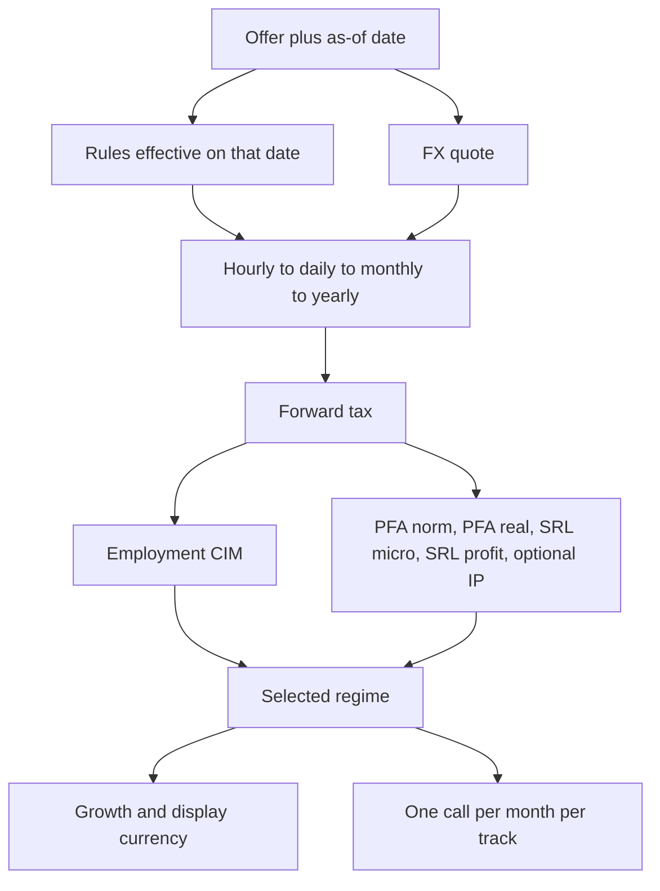

# Calculation flow

`POST /api/calculate` and the timeline runner both end in `calculate()` from `packages/engine`. Compare and the timeline do not invent a second tax formula.

## Rules

`resolveRules` keeps, for each key, the row with the latest `effective_from` that is still on or before the calculation date. The July 2026 minimum wage replaces the January value from 1 July onward. Other keys stay on their January rows.

If the date is in the future and later than every `effective_from` in the table, the latest known rules are used and `future_rules_assumed` is set. A result is `verified` only when every rule row it used has `verified = true`. Seeded rows are not verified, so normal results are not verified.

## FX

For a non-RON amount the quote is chosen in this order:

1. The offer's manual override for that currency.
2. The user's global override.
3. The latest `fx_rates` row on or before the date.

RON uses rate 1. Display conversion divides a RON figure by the display currency's rate. When the display currency is the offer's own currency, the offer's rate is used, so two EUR offers with different overrides can show the same EUR net and a different RON net. The gap between those growth rates is the FX effect.

Future timeline months multiply the last known rate by `(1 + drift) ^ years`. Drift defaults to 0, so the last rate is carried forward.

## Periods

- Hourly gross becomes daily gross using hours per day, then a nominal month using working days.
- Employment yearly gross is the nominal month times 12.
- B2B yearly revenue is the daily rate times billable days per year, so vacation and unpaid days are in the day count. Monthly figures shown for comparison are that year divided by 12.
- A monthly gross amount is kept as entered. It is not rebuilt from a rounded daily rate.

## Forward tax

Employment, per month: CAS and CASS on gross, then personal deduction and the minimum-wage allowance when those rules are enabled and the offer toggles them on, then 10% income tax on the taxable base unless the IT exemption is on. Net is gross minus CAS, CASS, and tax. Employer cost is gross plus CAM. A counted yearly bonus is taxed as an extra gross amount with no personal deduction.

B2B regimes take the yearly invoiced revenue:

- Norma de venit: income tax and CAS/CASS on the norm. Cash expenses reduce net, not the tax base.
- Sistem real: tax and contributions on revenue minus deductible expenses.
- SRL micro: turnover tax on revenue. Expenses, director gross, and employer CAM reduce distributable profit. Dividends are taxed, with CASS on dividends. Retained payout sets dividends to 0.
- SRL profit tax: 16% on profit after expenses, director pay, and CAM, then dividend tax and CASS.
- Intellectual property: a flat deduction (seeded at 40%) replaces itemised expenses in the tax base. It is omitted unless both the rule and the offer enable it.

CAS/CASS for independent income and for dividends use the tier model in `spikes/001-cas-cass-tier-model.md`. A zero norm is excluded when picking the best net.

## Reverse solve

For `MONTHLY_NET`, binary search finds the gross or the yearly revenue whose forward net matches the target. Benefits are added after the solve. For B2B the search uses the regime selected on the offer. `best` and a disabled IP regime fall back to PFA actual system for the solve. The other regimes are then run on that solved revenue so they can be compared.

## Timeline

`runTimeline` loops months. Raises that fall on the current month index are applied first. A percent on gross scales the amount. A percent on net, or a gross percent while the offer is still stored as monthly net, is turned into a new monthly net or monthly gross in RON by calling `calculate`. A one-off or annual bonus is the difference between a calculation with and without that extra gross, added to that month only.

Aggregates sum net, gross, and taxes. CAGR treats the span from the first month to the last as `(months - 1) / 12` years. Break-even is the first month in which track B's cumulative net catches track A.
