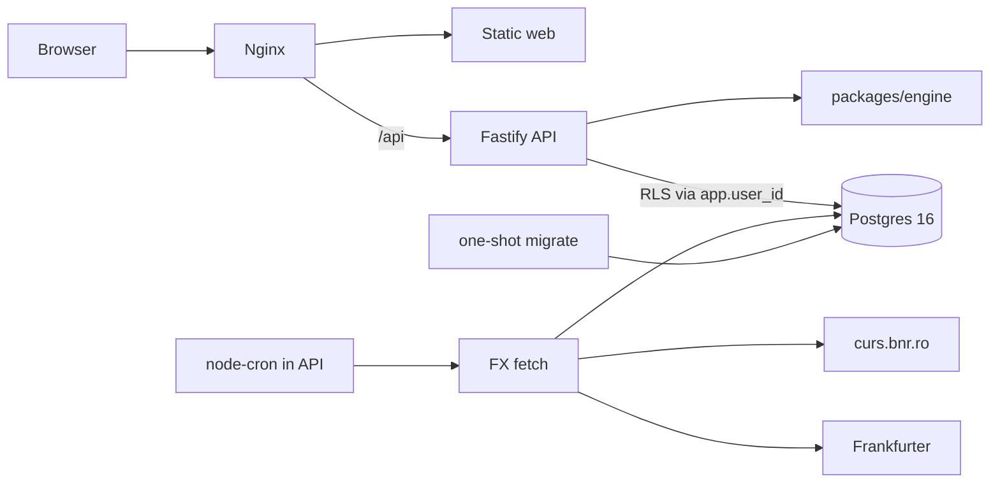

# Architecture

Offer Compare RO is a small Compose stack. The tax math is a pure TypeScript package. The API loads rules and FX rates, calls that package, and stores user data in Postgres.

## Services

| Service | Role |
| --- | --- |
| `db` | `postgres:16`. Named volume. Health check before migrations. |
| `migrate` | Runs SQL files in `db/migrations` as the database owner, creates the `app_user` role, then exits. |
| `api` | Fastify. Auth, CRUD, calculate, compare, timeline run, FX refresh. Connects as `app_user`. |
| `web` | Vite build served by nginx. `/api` is proxied to the API. |

The web app is also able to run with Vite's dev server, which proxies `/api` to port 3000.

## Request path

1. The browser sends `Authorization: Bearer` with a short-lived JWT. The refresh token is exchanged at `POST /api/auth/refresh`.
2. nginx forwards `/api` to Fastify.
3. For user-owned data the API opens a transaction and runs `SELECT set_config('app.user_id', <uuid>, true)`. Row-level security policies read that setting. The third argument makes the setting local to the transaction, so a pooled connection cannot leak it.
4. Calculation routes load `tax_rules` and `fx_rates`, then call `packages/engine`. The engine does not touch the database.

## Packages

- `packages/engine` exports offer types, rule resolution, period conversion, employment, the B2B regimes, `calculate`, `compare`, and `runTimeline`. Vitest covers it.
- `api` is the only process that talks to Postgres and the FX feeds.
- `web` renders the dashboard, offer editor, timelines, and settings. It does not reimplement tax math. Tooltips show formula strings returned by the engine.

## Main routes

- Auth: register, login, refresh, logout, me.
- Offers, settings, tax rules, inflation, FX list and refresh.
- `POST /api/calculate` for the live preview, including unsaved offers.
- `POST /api/compare` for the dashboard.
- Scenarios store a result plus the rules and FX used.
- Timelines, tracks, raises, `POST /api/timelines/:id/run`, and `POST /api/timelines/preview`.

`DELETE /api/timelines/:id` removes a timeline. Tracks, raises, and cached runs go with it because of `ON DELETE CASCADE`.
